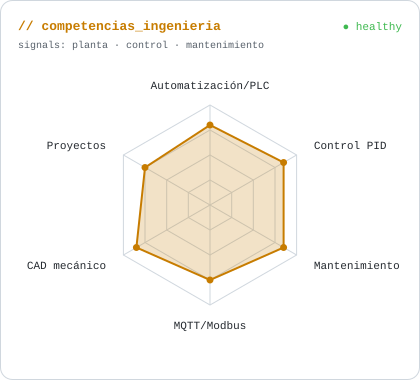
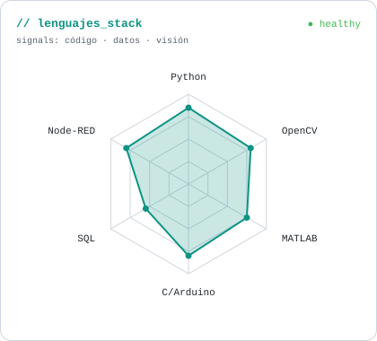

<!-- BANNER INDUSTRIAL (local, modo claro/oscuro) -->
<a href="https://sofiak-08.github.io">
  <picture>
    <source media="(prefers-color-scheme: dark)" srcset="assets/banner-dark.svg">
    <source media="(prefers-color-scheme: light)" srcset="assets/banner-light.svg">
    
  </picture>
</a>

 

---

## `$ whoami`

  

 

## `$ cat tech-stack.yaml`

<table border="1" cellpadding="14" bgcolor="#161b22">
  <thead>
    <tr>
      <th colspan="2" align="left"><code>sofiak-08:~$ cat tech-stack.yaml</code></th>
    </tr>
  </thead>
  <tbody>
    <tr>
      <td width="50%" valign="top"><code>├─ ⚙ automatizacion_control:</code>  
        
        
        
        
         
        <code>TIA Portal · PLC · SCADA/HMI · LabVIEW · Node-RED · P/PI/PID</code>
      </td>
      <td width="50%" valign="top"><code>├─ ⌁ protocolos_iiot:</code>  
        
         
        <code>MQTT · Modbus · TCP/IP · IoT</code>
      </td>
    </tr>
    <tr>
      <td valign="top"><code>├─ ◉ vision_artificial_ia:</code>  
        
         
        <code>OpenCV · TensorFlow · CNN/LSTM · YOLO · Roboflow · ROS (cert. IEEE)</code>
      </td>
      <td valign="top"><code>├─ ▣ sistemas_embebidos:</code>  
        
        
         
        <code>Arduino · ESP32 · Jetson Nano</code>
      </td>
    </tr>
    <tr>
      <td valign="top"><code>├─ ✦ cad_diseno_mecanico:</code>  
        
         
        <code>SolidWorks · Inventor · AutoCAD 2D/Electrical · Fritzing (PCB) · P&amp;ID</code>
      </td>
      <td valign="top"><code>╰─ ◈ datos_herramientas:</code>  
        
        
        
         
        <code>MATLAB · SQL · Pandas · Power BI · Excel (MRP/MPS) · Git · Notion</code>
      </td>
    </tr>
  </tbody>
  <tfoot>
    <tr>
      <td colspan="2"><code>status: ready&nbsp;&nbsp;·&nbsp;&nbsp;planta: online&nbsp;&nbsp;·&nbsp;&nbsp;idiomas: [es: nativo, en: B2]</code></td>
    </tr>
  </tfoot>
</table>

---

## `$ systemctl list-units --type=proyecto`

<table border="1" cellpadding="10" bgcolor="#161b22">
  <thead>
    <tr>
      <th align="left"><code>UNIT</code></th>
      <th align="left"><code>DESCRIPTION</code></th>
      <th align="left"><code>STATE</code></th>
    </tr>
  </thead>
  <tbody>
    <tr>
      <td><a href="https://github.com/sofiak-08/sofiak-08.github.io/blob/main/au_detector.py"><code>monitoreo-fatiga</code></a></td>
      <td>Detección de fatiga operacional por microexpresiones (FACS) con YOLO + Edge. Presentado en <b>JAUTI 2025</b>.</td>
      <td><code>🟢 research</code></td>
    </tr>
    <tr>
      <td><a href="https://a360.co/3RHfRHd"><code>brazo-robotico-4gdl</code></a></td>
      <td>Manipulador articulado de 4 GDL para pick &amp; place, modelado en SolidWorks/Inventor.</td>
      <td><code>🟢 active</code></td>
    </tr>
    <tr>
      <td><a href="https://www.notion.so/Plan-de-Mantenimiento-Industrial-36b0da33eaee80d3885ce0d8bc33aad3"><code>cmms-mantenimiento</code></a></td>
      <td>CMMS en Notion con alertas por telemetría y cálculo automático de MTTR.</td>
      <td><code>🟢 active</code></td>
    </tr>
    <tr>
      <td><a href="https://docs.google.com/spreadsheets/d/1X8Uy0ArCjh0LL9wZCEat6yTvRIvmtlBm/edit"><code>mrp-mps</code></a></td>
      <td>Planificación de la manufactura: BOM, hojas de ruta, MPS y lógica MRP estilo ERP.</td>
      <td><code>🟢 active</code></td>
    </tr>
    <tr>
      <td><code>industrial-data-platform</code></td>
      <td>Proyecto 05: pipeline Medallion (Bronze → Silver → Gold) con Python, Parquet, DuckDB y Docker.</td>
      <td><code>🟡 building</code></td>
    </tr>
  </tbody>
</table>

<code>→ detalle completo en <a href="https://sofiak-08.github.io">sofiak-08.github.io</a></code>

---

## `$ plc --read signals --all`

  <picture>
    <source media="(prefers-color-scheme: dark)" srcset="assets/radar-dark.svg">
    <source media="(prefers-color-scheme: light)" srcset="assets/radar-light.svg">
    
  </picture>&nbsp;
  <picture>
    <source media="(prefers-color-scheme: dark)" srcset="assets/radar-langs-dark.svg">
    <source media="(prefers-color-scheme: light)" srcset="assets/radar-langs-light.svg">
    
  </picture>

<code>signals: engineering_radar · language_stack_radar · learning: [IoT & Transformación Digital (Cisco NetAcad), cloud, data engineering] · status: healthy</code>

---

<!-- SOCIALS -->
## `$ connect --socials`

&nbsp;&nbsp;
&nbsp;&nbsp;
&nbsp;&nbsp;

 
 

Hecho con ⚙️ y mucho café desde Quito, Ecuador · @sofiak-08

